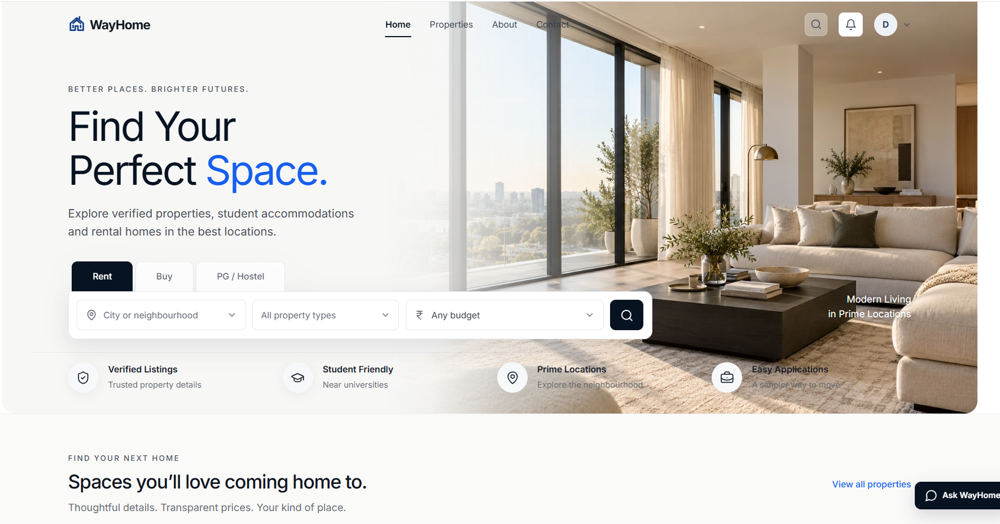
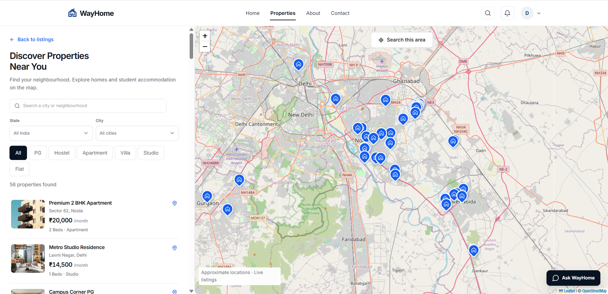
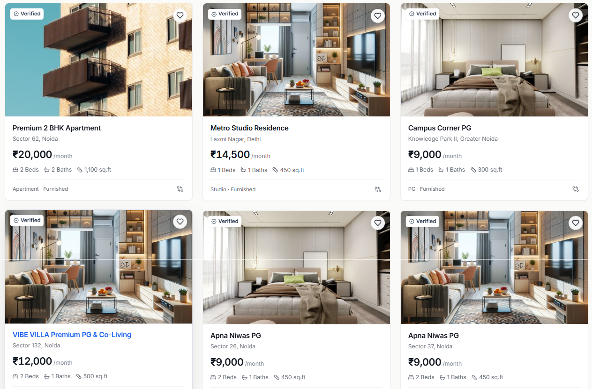

<p align="center">
  
</p>

<h1 align="center">WayHome</h1>

<p align="center">
  <strong>A modern real-estate and student-accommodation platform.</strong>
</p>

<p align="center">
  Discover properties • Search by location • Apply • List • Review • Manage
</p>

<p align="center">
  <a href="https://wayhomelive.vercel.app/">Live Website</a>
</p>

<p align="center">
  
  
  
  
  
  
  
</p>

---

## 📌 Overview

**WayHome** is a full-stack property platform designed to bring property discovery, student accommodation, rental applications, property listing management, and administrative review into one system.

The platform is built around four user roles:

| Role | What they can do |
|---|---|
| 🎓 **Student** | Discover student accommodation, explore properties and manage applications |
| 🏠 **Tenant** | Search rental properties, save homes and apply |
| 🔑 **Property Owner** | Create and manage listings and track listing status |
| 🛡️ **Admin** | Review listings, approve/reject submissions and manage the platform |

---

# 🖥️ Interface Preview

### Home Page

<p align="center">
  
</p>

The home page provides a simple entry point for property discovery with rent, buy and PG/hostel search options.

### Property Discovery

<p align="center">
  
</p>

The property discovery experience combines filters, property results and an interactive map to help users explore available homes by location.

### Property Cards

<p align="center">
  
</p>

Property cards surface the information users need at a glance, including verification, location, price, bedrooms, bathrooms and area.

---

# ✨ Core Features

## 🏡 Property Discovery

- Property search
- City and neighbourhood search
- Property-type filtering
- Budget filtering
- Bedroom and bathroom information
- Furnishing information
- Verified property indicators
- Property detail pages
- Interactive map-based discovery
- Saved/favourite properties

## 🎓 Student Accommodation

WayHome also supports accommodation discovery for students, including:

- PG
- Hostel
- Apartment
- Villa
- Studio
- Flat
- University/location-based discovery

## 👤 Authentication

The application supports role-based access with:

- Account registration
- Login
- Email OTP verification
- Password authentication
- Password recovery
- JWT-based sessions
- Protected routes
- Role-aware dashboards

## 🏠 Property Owner

Owners can:

1. Create a property listing
2. Add property information
3. Upload property images
4. Submit the listing
5. Track its review status
6. Edit/manage their listings
7. View applications and related information

---

# 🛡️ Property Approval System

One of the important workflows in WayHome is the **admin-controlled property approval process**.

A newly submitted property does not immediately become public.

```text
Property Owner
      │
      ▼
Create Listing
      │
      ▼
Submit Property
      │
      ▼
┌─────────────────┐
│     PENDING     │
│   Under Review  │
└────────┬────────┘
         │
         ▼
    Admin Review
      /       \
     /         \
    ▼           ▼
APPROVED     REJECTED
    │           │
    ▼           ▼
Verified      Rejection
  = true       Reason
    │
    ▼
Public Website
```

### Listing Status

| Status | Meaning | Public visibility |
|---|---|---|
| 🟡 **PENDING** | Waiting for admin review | Hidden |
| 🟢 **APPROVED** | Approved and verified | Visible |
| 🔴 **REJECTED** | Rejected by admin | Hidden |

When an admin rejects a property, the rejection reason is retained so the owner can understand what needs to be corrected.

---

# 🛡️ Admin Workspace

The admin role acts as the moderation and management layer of the platform.

### Admin responsibilities

- Review property submissions
- Approve listings
- Reject listings
- Add rejection reasons
- Manage users
- Monitor platform activity
- Control administrative workflows

This creates a clear separation between **owner submission** and **public publication**.

---

# 🔄 User Journey

```text
                    WAYHOME
                       │
          ┌────────────┼────────────┐
          ▼            ▼            ▼
       Student       Tenant       Owner
          │            │            │
          ▼            ▼            ▼
    Find Housing   Find Home    List Property
          │            │            │
          ▼            ▼            ▼
       Details      Details      Submit
          │            │            │
          ▼            ▼            ▼
       Apply         Apply       Pending
          │            │            │
          │            │            ▼
          │            │        Admin Review
          │            │          /     \
          │            │         ▼       ▼
          │            │     Approved  Rejected
          │            │         │       │
          │            │         ▼       ▼
          │            │       Public   Reason
          │            │       Listing
          ▼            ▼
       Applications & Communication
```

---

# 🏗️ System Architecture

```text
┌──────────────────────────────────────────────┐
│                  WAYHOME UI                  │
│              React + Vite Frontend           │
└──────────────────────┬───────────────────────┘
                       │
                       │ REST API
                       ▼
┌──────────────────────────────────────────────┐
│              SPRING BOOT BACKEND             │
│                                              │
│ Controllers → Services → Repositories        │
│                                              │
│ Spring Security + JWT                        │
└───────────────┬──────────────────┬───────────┘
                │                  │
                ▼                  ▼
        ┌──────────────┐    ┌──────────────┐
        │    MySQL     │    │ Email / OTP  │
        │   Database   │    │    Brevo     │
        └──────────────┘    └──────────────┘
```

### Technology Stack

| Layer | Technology |
|---|---|
| Frontend | React 18 |
| Build Tool | Vite |
| Styling | Tailwind CSS |
| Routing | React Router |
| UI / Motion | Framer Motion |
| Maps | React Leaflet |
| Backend | Spring Boot |
| Security | Spring Security + JWT |
| Database | MySQL |
| Email / OTP | Brevo |
| Frontend Hosting | Vercel |
| Backend Hosting | Railway |
| Version Control | Git + GitHub |

---

# 📂 Project Structure

```text
WayHome/
│
├── frontend/
│   ├── src/
│   │   ├── components/
│   │   ├── pages/
│   │   ├── context/
│   │   ├── services/
│   │   ├── data/
│   │   ├── utils/
│   │   └── styles/
│   ├── public/
│   ├── package.json
│   └── vercel.json
│
├── backend/
│   ├── src/main/java/
│   │   └── com/wayhome/
│   │       ├── controller/
│   │       ├── service/
│   │       ├── repository/
│   │       ├── model/
│   │       ├── dto/
│   │       ├── security/
│   │       └── exception/
│   │
│   ├── src/main/resources/
│   ├── pom.xml
│   └── Dockerfile
│
├── docs/
│   └── assets/
│
├── Architecture.md
├── Design.md
├── PRD.md
├── Rules.md
├── Task.md
└── README.md
```

---

# ⚙️ Local Setup

## Prerequisites

Make sure you have:

- Node.js
- Java / JDK
- Maven
- MySQL
- Git

## 1. Clone the repository

```bash
git clone <repository-url>
cd WayHome
```

## 2. Start the backend

```bash
cd backend
mvn spring-boot:run
```

Backend:

```text
http://localhost:8080
```

## 3. Start the frontend

Open another terminal:

```bash
cd frontend
npm install
npm run dev
```

Frontend:

```text
http://localhost:5173
```

---

# 🔐 Environment Variables

Create the required environment configuration using the project's `.env.example` files.

Typical configuration includes:

```env
DB_URL=
DB_USERNAME=
DB_PASSWORD=

JWT_SECRET=

BREVO_API_KEY=
BREVO_SENDER_EMAIL=

FRONTEND_URL=
```

> ⚠️ Never commit real passwords, API keys, JWT secrets or production credentials to GitHub.

---

# 🗄️ Database

MySQL is used as the persistent data layer.

The application uses database-backed information for areas such as:

- Users
- Properties
- Property images
- Student accommodation
- Applications
- Messages
- Notifications
- Agreements
- Listing status
- Verification state
- Rejection reasons

---

# 📧 Email & OTP

WayHome includes email-based verification for authentication flows.

The email service is integrated with **Brevo** and is used for OTP delivery.

```text
User enters email
       ↓
Backend generates OTP
       ↓
Email service
       ↓
OTP delivered to inbox
       ↓
User enters OTP
       ↓
Backend verifies OTP
       ↓
Authenticated session
```

---

# 🚀 Deployment

The current deployment architecture separates the frontend and backend:

```text
GitHub
  │
  ├──────────────► Vercel
  │                 │
  │                 ▼
  │             React App
  │
  └──────────────► Railway
                    │
                    ▼
               Spring Boot API
                    │
                    ▼
                  MySQL
```

### Production Checklist

- [ ] Production environment variables configured
- [ ] Database connection verified
- [ ] CORS configured
- [ ] JWT secret configured securely
- [ ] Email / OTP verified
- [ ] Authentication tested
- [ ] Owner listing flow tested
- [ ] Admin approval flow tested
- [ ] Rejection reason tested
- [ ] Public visibility tested
- [ ] Frontend production build tested

---

# 🧪 Important Functional Tests

Before considering a release complete, verify:

### Authentication
- [ ] Register
- [ ] Login
- [ ] OTP email
- [ ] OTP verification
- [ ] Logout
- [ ] Password recovery

### Property Discovery
- [ ] Search
- [ ] Filters
- [ ] Property cards
- [ ] Property details
- [ ] Map
- [ ] Favourites

### Owner
- [ ] Add property
- [ ] Upload images
- [ ] Submit listing
- [ ] View My Listings
- [ ] See `PENDING`
- [ ] See `APPROVED`
- [ ] See `REJECTED`
- [ ] See rejection reason

### Admin
- [ ] Login as Admin
- [ ] View pending properties
- [ ] Approve property
- [ ] Reject property
- [ ] Add rejection reason
- [ ] Verify approved listing becomes public

---

# 📚 Project Documentation

Additional project documentation is available in the repository:

| File | Purpose |
|---|---|
| `PRD.md` | Product requirements |
| `Architecture.md` | Technical architecture |
| `Design.md` | Design system and UI direction |
| `Rules.md` | Project rules |
| `Task.md` | Development tasks |

---

# 🎯 What Makes WayHome Different?

WayHome is designed as more than a basic property listing website.

It connects the complete journey:

```text
DISCOVER
   ↓
SEARCH
   ↓
COMPARE
   ↓
APPLY
   ↓
COMMUNICATE
   ↓
MANAGE
   ↓
ADMIN REVIEW
   ↓
PUBLISH
```

The platform combines **property discovery, student accommodation, role-based authentication, owner listing management, applications, communication and admin-controlled verification** into one full-stack application.

---

# 🌐 Live Project

<p align="center">
  <a href="https://wayhomelive.vercel.app/">
    <strong>🚀 Open WayHome</strong>
  </a>
</p>

---

<p align="center">
  
</p>

<p align="center">
  <strong>WayHome</strong><br>
  Better places. Brighter futures.
</p>
